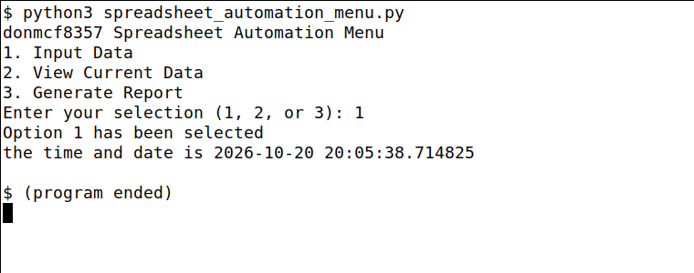

# Spreadsheet Automation Menu

**Student:** Donavan McFadden
**Student ID:** donmcf8357

## How to Run

1. Make sure Python 3 is installed (`python3 --version`).
2. Open a terminal in this folder.
3. Run the program:

   ```
   python3 spreadsheet_automation_menu.py
   ```

   On Windows you may need to use `python spreadsheet_automation_menu.py` or `py spreadsheet_automation_menu.py`.
4. Type `1`, `2`, or `3` when asked, then press Enter.
5. The program confirms your choice, prints the current date and time, and ends.

## Sample Output



```
donmcf8357 Spreadsheet Automation Menu
1. Input Data
2. View Current Data
3. Generate Report
Enter your selection (1, 2, or 3): 1
Option 1 has been selected
the time and date is 2026-10-20 20:05:38.714825
```

## My Explanation

For this project I wrote a short Python program that works as the starting menu for a spreadsheet automation tool. First, I imported `datetime` with `from datetime import datetime` so I could show the current date and time. I saved my student ID as a string so that any leading zeros would stay in place, and the program prints it with the title on the very first line. Next, I used three separate `print()` statements to show the menu options in order. Then I used `input()` to get the user's choice and saved it in a variable named `selected_option`, with the required comment placed right above that line. After that, the program tells the user which option they picked and prints the date and time using `datetime.now()`. I tested the program three times, once each with options 1, 2, and 3, and each run showed the right option and a current timestamp. The program stops after the confirmation because this assignment only covers the menu, the input, and the confirmation.

## Files

- `spreadsheet_automation_menu.py`: the Python program
- `output_screenshot.png`: screenshot of a successful run
- `README.md`: this file

## References

- Python Software Foundation. (n.d.). *Built-in functions: input() and print()*. Python 3 Documentation. https://docs.python.org/3/library/functions.html
- Python Software Foundation. (n.d.). *datetime.now() documentation*. Python 3 Documentation. https://docs.python.org/3/library/datetime.html#datetime.datetime.now
- GitHub. (n.d.). *Creating your first repository using GitHub Desktop*. GitHub Docs. https://docs.github.com/en/desktop/overview/creating-your-first-repository-using-github-desktop
- GitHub. (n.d.). *Pushing changes to GitHub from GitHub Desktop*. GitHub Docs. https://docs.github.com/en/desktop/making-changes-in-a-branch/pushing-changes-to-github-from-github-desktop
